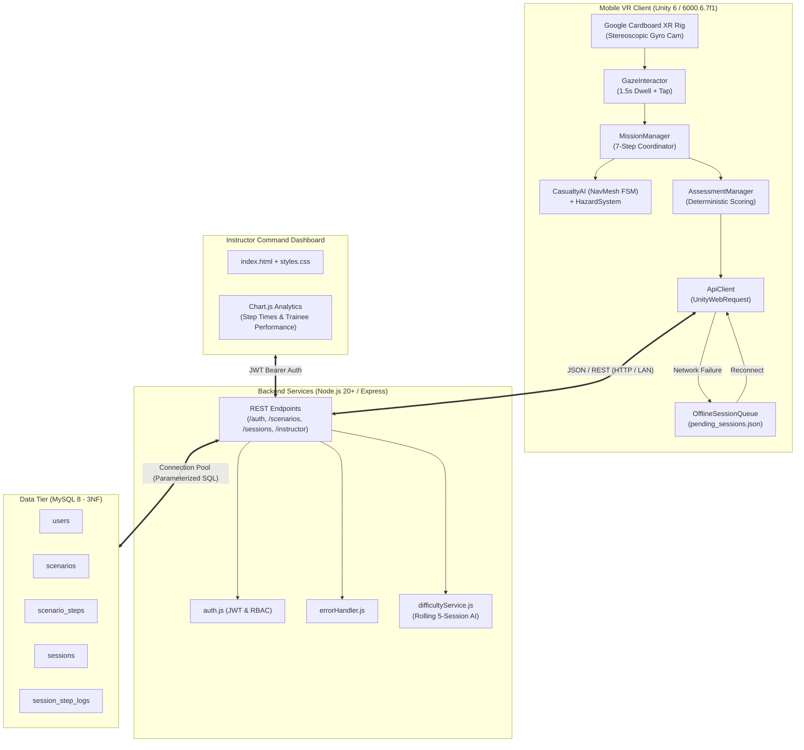
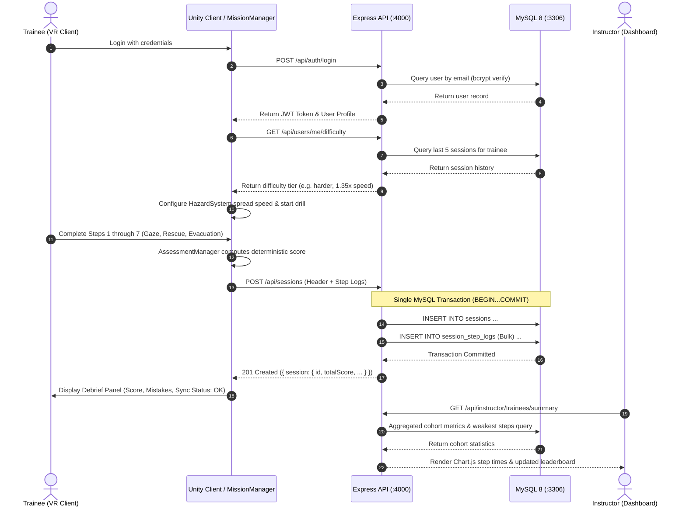
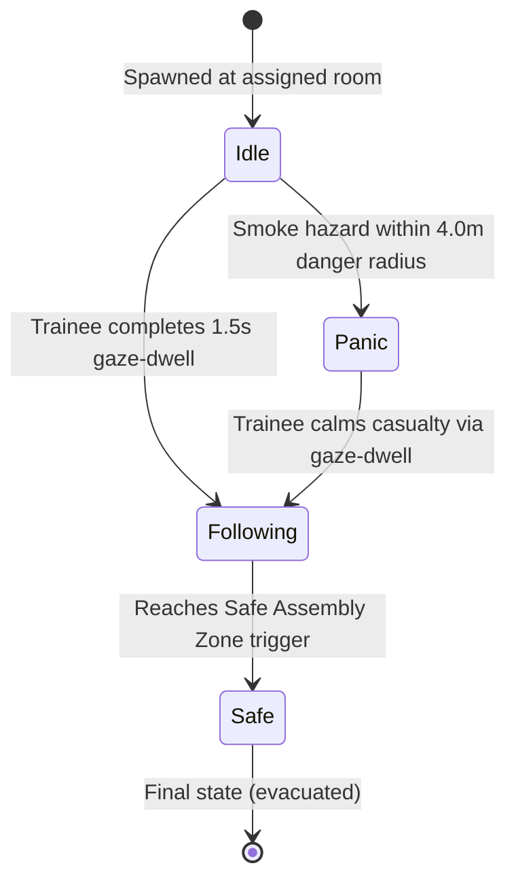
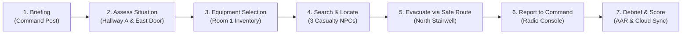
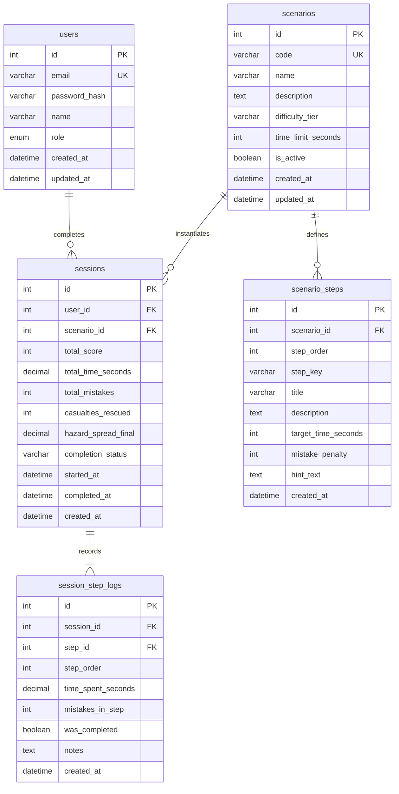
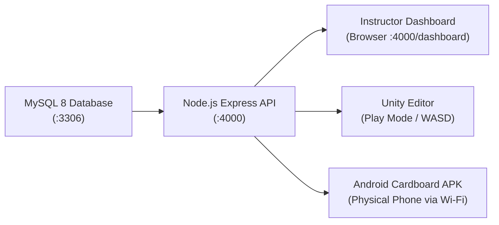

# DrillVR: AI-Driven Mobile VR Live Training Drills

[](https://drillvr-simulation.netlify.app)
[](https://github.com/hackerrorwottt/DrillVR)

> 🌐 **Live Web Application:** [https://drillvr-simulation.netlify.app](https://drillvr-simulation.netlify.app)  
> Interactive Instructor Command Dashboard with real-time 3D simulation telemetry, cohort analytics, and adaptive difficulty evaluation.

An immersive, low-cost, AI-driven mobile Virtual Reality training and evaluation system for live building emergency response drills, built with **Unity 6 (6000.6.7f1, Google Cardboard XR)**, **Node.js 20+ Express**, **MySQL 8 (3NF)**, and a **Chart.js Instructor Command Dashboard**.

> **Educational Prototype Disclaimer:** DrillVR is an academic prototype inspired by the problem statement *"Augmented/Virtual Reality system for the live training of troops"* (Ministry of Home Affairs, 2023, Smart Automation, Software). It contains **no weapons or combat content**. Simulation scores are for educational demonstration only and must not be presented as proof of real-world qualification. Augmented Reality (AR) is future scope only.

---

## Table of Contents
1. [Executive Summary & Background](#executive-summary--background)
2. [Core Problems Solved & Innovation](#core-problems-solved--innovation)
3. [Course Requirements Demonstrated](#course-requirements-demonstrated)
4. [Tech Stack](#tech-stack)
5. [System Architecture & Data Flow](#system-architecture--data-flow)
6. [Subsystems Deep-Dive](#subsystems-deep-dive)
   - [1. Mobile VR Client & Gaze Interaction](#1-mobile-vr-client--gaze-interaction)
   - [2. Autonomous AI & Behavioral Simulation](#2-autonomous-ai--behavioral-simulation)
   - [3. Deterministic Scoring & Assessment Engine](#3-deterministic-scoring--assessment-engine)
   - [4. Backend, 3NF Database & Offline Resilience](#4-backend-3nf-database--offline-resilience)
   - [5. Instructor Command & Analytics Dashboard](#5-instructor-command--analytics-dashboard)
7. [Repository Layout](#repository-layout)
8. [Core Drill Scenario: 7-Step Building Emergency](#core-drill-scenario-7-step-building-emergency)
9. [Database Design (3NF) & Schema Documentation](#database-design-3nf--schema-documentation)
10. [REST API Specification](#rest-api-specification)
11. [Seeded Test Accounts & Performance Profiles](#seeded-test-accounts--performance-profiles)
12. [Comprehensive "How to Run" Guide](#comprehensive-how-to-run-guide)
    - [Prerequisites](#prerequisites)
    - [Part 1: Backend, Database & Instructor Dashboard](#part-1-backend-database--instructor-dashboard)
    - [Part 2: Unity Editor Test Mode (No Phone Needed)](#part-2-unity-editor-test-mode-no-phone-needed)
    - [Part 3: Android Physical Phone + Google Cardboard APK](#part-3-android-physical-phone--google-cardboard-apk)
    - [Part 4: Offline Queue & Resilience Testing](#part-4-offline-queue--resilience-testing)
    - [Part 5: Troubleshooting & Common Gotchas](#part-5-troubleshooting--common-gotchas)
13. [Verification, Testing & Performance Benchmarks](#verification-testing--performance-benchmarks)
14. [Milestones Summary (M1 to M9)](#milestones-summary-m1-to-m9)
15. [Documentation & Viva Resources](#documentation--viva-resources)

---

## Executive Summary & Background

### Problem Context (MHA 2023 — Smart Automation, Software)
In civil defense, emergency services, and troop base security, regular building emergency drills (evacuation, fire/smoke response, casualty search and rescue) are mission-critical. However, real-world physical drills suffer from severe structural drawbacks:
- **High Operational Costs & Logistics:** Evacuating operational facilities, staging actors, and deploying physical smoke generators requires extensive logistical coordination and downtime.
- **Safety Hazards:** Inexperienced personnel exposed to real smoke simulators, darkened stairwells, or panic situations face authentic injury risks.
- **Subjective & Incomplete Telemetry:** Physical drills rely on instructors taking manual notes on clipboards. Exact reaction times, pathing errors, equipment selection mistakes, and step durations cannot be objectively captured or replayed.
- **Static, Non-Adaptive Scenarios:** In real drills, scenario parameters remain fixed. Fast learners are uncurbed, while struggling trainees repeat the same mistakes without targeted intervention.
- **Prohibitive Hardware Barrier:** Commercial enterprise and PC VR solutions (e.g., Meta Quest 3/Pro or HTC Vive Focus 3, typically retailing at ~$500 to $1,500+ USD MSRP) require dedicated headset hardware and high-spec computing that can be cost-prohibitive for large-scale institutional rollouts across distributed barracks or training academies.

### The DrillVR Solution
DrillVR delivers a standardized, accessible, software-driven VR training platform running on **consumer Android smartphones (Android 8.0+, typically ~$120–$250 USD / ~₹10,000–₹20,000 INR)** paired with **Google Cardboard V2 viewers (typically ~$5–$15 USD / ~₹400–₹1,200 INR)**. Trainees experience an immersive, stereoscopic emergency response drill that adapts dynamically to their performance, while instructors supervise cohort metrics via a centralized web dashboard powered by a normalized 3NF MySQL database.

---

## Core Problems Solved & Innovation

| Challenge | Traditional Approach | DrillVR Innovation |
|---|---|---|
| **Hardware Accessibility** | Commercial standalone/PC VR headsets (~$500–$1,500+ USD MSRP) | Low-cost Cardboard viewer (~$5–$15 USD) using trainee smartphones with Built-in Render Pipeline optimized for mobile GPUs |
| **Motion Sickness (Cybersickness)** | Smooth analog stick locomotion causing severe vestibular-ocular mismatch | Instantaneous comfort teleportation to discrete floor pads with zero rotational acceleration |
| **Hands-Free Mobile Interaction** | Dual 6-DOF tracked controllers | Gaze reticle + 1.5s radial dwell ring timer + single-tap capacitive screen touch |
| **Static Drills** | Scripted, identical hazard spread | Dynamic AI: `HazardSystem` smoke expansion scales with trainee skill; `CasualtyAI` NPCs flee danger autonomously |
| **Subjective Evaluation** | Instructor clipboard notes | Granular per-step execution telemetry (tracking step duration in decimal seconds, mistake counts, and hazard exposure times); deterministic multi-attribute scoring |
| **Field Connectivity Gaps** | Cloud-dependent systems fail in basements / remote sites | Persistent local queue (`pending_sessions.json`) with automatic FIFO sync on reconnection |
| **Instructor Oversight** | Fragmented spreadsheets | Interactive HTML5 + Chart.js dashboard showing cohort averages, weakest steps, and leaderboard rankings |

---

## Course Requirements Demonstrated

1. **Mobile VR Application Development (Unity 3D):**
   - Stereoscopic rendering via Google Cardboard XR SDK (`com.google.xr.cardboard` pinned at `#v1.30.0`).
   - Hands-free gaze interaction with dynamic reticle and `1.5s` radial fill dwell timer, alongside single-tap screen touch support.
   - Comfortable point-and-teleport locomotion via dedicated floor pads with parabolic gaze arc.
   - Low-draw-call, mobile-optimized environment using Unity 3D primitives, baked lightmaps, ambient audio, and a live in-VR FPS counter targeting a minimum sustained budget of $\ge 30\,\text{FPS}$ (frame budget: $\le 33.3\,\text{ms/frame}$; physical handset measurements to be recorded via `FpsOverlay.cs`).
   - Seamless Editor test harness: mouse look (holding Right Mouse Button or toggling cursor lock with `L`), keyboard WASD walking, and left-click interaction.

2. **Basic AI Inside VR:**
   - **Casualty NPCs (`CasualtyAI`):** Unity `NavMeshAgent` state machine (`Idle`, `Panic`, `Following`, `Safe`) with dynamic waypoint patrol, smoke-proximity flee response, and doorway/stairwell pathfinding.
   - **Dynamic Hazard Simulation (`HazardSystem`):** Expanding smoke zone (`ParticleSystem` + trigger `SphereCollider`) whose radial spread speed scales with trainee difficulty tier.
   - **Virtual Instructor (`HintSystem`):** Context-aware guidance panel driven by the active step and trainee mistake history (toggleable on/off).
   - **Adaptive Difficulty Engine (`difficultyService.js`):** Evaluates the trainee's rolling 5-session average mistakes (`avg <= 2` → `harder` at `1.35x` hazard speed; `3–5` → `normal` at `1.00x`; `> 5` → `easier` at `0.70x` with extra hints enabled).

3. **Sound Application Design with Backend & DBMS:**
   - **Database:** Normalized 3NF MySQL 8 schema (5 tables: `users`, `scenarios`, `scenario_steps`, `sessions`, `session_step_logs`) with foreign keys, cascading constraints, and compound indexes.
   - **Backend API:** Node.js 20+ Express server with parameterized SQL queries via `mysql2/promise` (zero SQL injection), JWT authentication, `bcrypt` password hashing, and role-based access control (`trainee`, `instructor`, `admin`).
   - **Transaction Integrity:** Session creation and multi-step telemetry logs persist atomically within a single database transaction (`BEGIN...COMMIT / ROLLBACK`).
   - **Offline Resilience:** Unity client queues session logs in persistent JSON storage (`pending_sessions.json`) if the network drops, automatically flushing when connectivity restores.
   - **Automated Verification:** Comprehensive Jest + Supertest integration test suite covering auth, difficulty rules, session transactions, and RBAC routes.
   - **Analytics Dashboard:** Responsive Instructor Dashboard built with HTML5, CSS3, Vanilla JS, and Chart.js, rendering trainee performance metrics, step completion bar charts, and historical trends.

---

## Tech Stack

```text
+-----------------------------------------------------------------------------------+
|                                     DrillVR                                       |
+-----------------------------------------------------------------------------------+
| Mobile VR Client    : Unity 6 (6000.6.7f1, Built-in Pipeline, C#)                  |
| XR Subsystem        : Google Cardboard XR Plugin (#v1.30.0) + XR Management 4.5.4 |
| AI & Navigation     : Unity AI Navigation (1.1.7) + NavMeshAgent FSM              |
| Backend API         : Node.js 20+ / Express 4 / mysql2 / JWT / bcrypt             |
| Relational Database : MySQL 8.0+ (3NF Normalization, 5 Tables)                    |
| Testing Suite       : Jest 29+ & Supertest 7+                                     |
| Instructor Web UI   : HTML5 / CSS3 (Dark Theme) / Vanilla JS / Chart.js 4.4.4     |
| Target Deployment   : Android 8.0+ (API 26-34), ARM64, Google Cardboard           |
+-----------------------------------------------------------------------------------+
```

---

## System Architecture & Data Flow

DrillVR follows a decoupled 4-tier architecture designed for low-latency simulation, robust security, and reliable data persistence.



### End-to-End Execution Sequence


---

## Subsystems Deep-Dive

### 1. Mobile VR Client & Gaze Interaction

#### Gaze Reticle & Dwell Pipeline
- **Reticle Raycasting:** A world-space camera ray shoots forward from the center of the viewport (`GazeInteractor.cs`).
- **Interaction Target:** When colliding with any collider implementing `Interactable.cs`, a circular progress ring begins to lerp:
  $$\text{Dwell Fill} = \frac{\Delta t_{\text{gazing}}}{1.5\,\text{seconds}}$$
- **Visual Feedback:** The reticle smoothly scales up and changes color from white to high-contrast cyan, giving intuitive feedback without obscuring the environment.
- **Single-Tap Acceleration:** Trainees can bypass the 1.5s timer by pressing the Google Cardboard capacitive trigger or tapping the phone screen, immediately invoking `OnInteract()`.

#### Comfort Point-and-Teleport Locomotion
- To eliminate simulator sickness caused by vestibular-ocular disparity, smooth locomotion is strictly disabled in VR mode.
- Discrete green teleportation disks (`TeleportPoint.cs`) are positioned at strategic observation points.
- Gaze-dwelling on a teleport pad triggers an instantaneous translation of the player root with zero linear or angular acceleration, maintaining comfortable orientational stability.

#### Dual-Mode Editor Test Harness
- In the Unity Editor, developers can test without wearing a headset:
  - **Mouse Look:** Hold Right Mouse Button or press **`L`** to toggle cursor lock.
  - **Keyboard Walk:** **WASD** or arrow keys move the player.
  - **Input Field Isolation:** `EditorWalkController.cs` automatically detects when the trainee clicks into UI input fields (e.g., Login Email/Password), instantly muting WASD movement to avoid accidental movement while typing.

---

### 2. Autonomous AI & Behavioral Simulation

#### Casualty NPCs (`CasualtyAI`)
The environment contains 3 civilian casualty NPCs (Officer Raj, Civilian Priya, Worker Amit), each driven by a 4-state Finite State Machine backed by Unity's `NavMeshAgent`:



- **`Idle`:** Casualty stands in designated room, periodically playing subtle idle animations and awaiting rescue.
- **`Panic`:** If the expanding smoke hazard approaches within `4.0m`, the casualty panics, plays frantic audio cues, and attempts to flee towards secondary waypoints.
- **`Following`:** Once mustered by the trainee's gaze interaction, the casualty switches to `Following` mode, pathfinding dynamically behind the trainee while respecting doorway and corridor constraints (`stoppingDistance = 1.8m`).
- **`Safe`:** Upon crossing the threshold of the exterior `SafeRouteZone`, the casualty transitions to `Safe`, uncouples from the trainee, and marks the rescue step complete.

#### Dynamic Hazard Simulation (`HazardSystem`)
- Simulates an expanding smoke volume originating from an electrical fault in the East Corridor.
- Built using a high-density Unity `ParticleSystem` combined with an expanding trigger `SphereCollider`.
- **Dynamic Growth Equation:**
  $$R(t) = R_0 + (v_{\text{base}} \cdot m_{\text{diff}}) \cdot t$$
  Where $R_0 = 1.5\,\text{m}$, $v_{\text{base}} = 0.08\,\text{m/s}$, and $m_{\text{diff}}$ is the trainee's server-assigned difficulty multiplier ($0.70\times$, $1.00\times$, or $1.35\times$).
- **Hazard Consequences:** Entering the smoke collider triggers visual screen vignetting, persistent coughing audio, and accumulates hazard exposure time that penalizes the trainee's final score.

#### Virtual Instructor (`HintSystem`)
- Context-aware assistance engine that monitors the trainee's current step and elapsed time.
- If a trainee remains on a single step for longer than 30 seconds without progress, the system surfaces a prominent World-Space guidance panel with clear instructional cues (e.g. *"Look for the green floor pads down the North Hallway"*).
- Trainees can toggle the hint panel ON or OFF at any time via a gaze button on their HUD.

#### Adaptive Difficulty Engine (`difficultyService.js`)
DrillVR adapts drill difficulty automatically based on the trainee's historical performance over their last 5 completed sessions:

$$\overline{M} = \frac{1}{N} \sum_{i=1}^{N} \text{total\_mistakes}_i \quad (N \le 5)$$

| Average Mistakes ($\overline{M}$) | Assigned Tier | Hazard Multiplier ($m_{\text{diff}}$) | Virtual Hints Behavior | Target Trainee Profile |
|---|---|---|---|---|
| **$\overline{M} \le 2.0$** | `harder` | **$1.35\times$** | Available on-demand | High performer requiring stress testing |
| **$2.0 < \overline{M} \le 5.0$** | `normal` | **$1.00\times$** | Available on-demand | Standard baseline trainee |
| **$\overline{M} > 5.0$** | `easier` | **$0.70\times$** | **Forced Active** + early prompts | Struggling trainee requiring guided remediation |

---

### 3. Deterministic Scoring & Assessment Engine

The `AssessmentManager.cs` evaluates performance deterministically based on four objective factors:

$$\text{Final Score} = \max\left(0, \min\left(100, 100 - P_{\text{mistakes}} - P_{\text{time}} - P_{\text{casualties}} - P_{\text{hazard}}\right)\right)$$

#### Penalty Deductions Matrix
| Category | Penalty Formula | Description |
|---|---|---|
| **Step Mistakes** | $P_{\text{mistakes}} = \sum (\text{mistakes}) \times 5\,\text{pts}$ | Wrong equipment selected, distractor picked, wrong route attempted |
| **Time Overrun** | $P_{\text{time}} = \sum \max(0, t_{\text{step}} - t_{\text{target}}) \times 2\,\text{pts/s}$ | Exceeding the target par time for any step |
| **Unrescued Casualties** | $P_{\text{casualties}} = (3 - N_{\text{rescued}}) \times 15\,\text{pts}$ | Failing to muster and evacuate all 3 civilian casualties |
| **Hazard Exposure** | $P_{\text{hazard}} = \min(20, t_{\text{smoke}} \times 3\,\text{pts/s})$ | Standing inside the active smoke collider zone |

#### Performance Grade Classifications
- **Grade S (90–100):** Exemplary response; rapid triage and zero protocol violations.
- **Grade A (80–89):** Proficient; all casualties evacuated within acceptable time limits.
- **Grade B (70–79):** Competent; minor equipment hesitation or route detour.
- **Grade C (60–69):** Marginal pass; high time overrun or hazard proximity penalties.
- **Needs Retraining (< 60):** Failed drill; casualties abandoned or severe protocol non-compliance.

---

### 4. Backend, 3NF Database & Offline Resilience

#### Relational 3NF Architecture
The database is strictly normalized to Third Normal Form (3NF) to eliminate data redundancy and preserve referential integrity:
- Every non-key attribute is non-transitively dependent on the primary key.
- Cascading deletes ensure scenario step alterations maintain clean session history.
- High-frequency query columns (`user_id`, `scenario_id`, `completed_at`, `total_score`) are indexed with composite B-tree indexes.

#### Single-Transaction Atomicity
When a trainee completes a drill, Unity dispatches a structured `POST /api/sessions` payload containing the session header and an array of 7 individual step logs. The backend wraps the entire write inside an atomic database transaction:
```javascript
const connection = await pool.getConnection();
try {
  await connection.beginTransaction();
  // 1. Insert master session record
  const [sessResult] = await connection.execute(insertSessionSql, sessionParams);
  // 2. Bulk insert granular step logs
  await connection.query(insertStepLogsSql, [stepLogRows]);
  // 3. Atomically commit both operations
  await connection.commit();
} catch (err) {
  await connection.rollback();
  throw err;
} finally {
  connection.release();
}
```
This guarantees that an interrupted network connection or server restart can **never** create orphaned sessions or partial step records.

#### Offline Queue & Recovery (`OfflineSessionQueue.cs`)
For field deployments where Wi-Fi is intermittent or unavailable in basement bunkers:
1. If the API endpoint is unreachable, the Unity client serializes the session payload to an encrypted local JSON file:
   `<Application.persistentDataPath>/pending_sessions.json`.
2. The trainee receives an in-VR notification: *"Offline: saved locally to queue"*.
3. When network connectivity is restored, the client reads the queue file and flushes each pending session via FIFO order to the backend, updating the server without data loss.

---

### 5. Instructor Command & Analytics Dashboard

The Instructor Command Dashboard is a lightweight, zero-build single-page application built with **HTML5, CSS3, and Chart.js 4.4.4**:
- **Authentication & RBAC:** Protected by JWT authentication; accessible only to users with `instructor` or `admin` roles.
- **Executive Cohort KPIs:** Live tiles displaying total active trainees, aggregate drills completed, cohort average score, and cohort average completion time.
- **Interactive Step Duration Chart:** A dynamic Chart.js bar chart showing average time spent per drill step across all trainees, instantly revealing organizational bottlenecks.
- **Dynamic Weakest Step Detection:** The backend analyzes all `session_step_logs` per trainee and calculates their individual `weakestStep` (the step with the highest accumulated mistake count), allowing instructors to target personal retraining.
- **Real-Time Leaderboard:** Trainee rankings ordered by average score, displaying best score, total sessions, and achievement tier badges.

---

## Repository Layout

```text
DrillVR/
├── unity-client/
│   ├── Packages/
│   │   └── manifest.json               # Pinned Cardboard XR & AI Navigation packages
│   └── Assets/
│       ├── Editor/                     # Automated scene & ScriptableObject builders (M1–M8)
│       │   ├── Milestone1Setup.cs      # XR bootstrap & reticle test scene
│       │   ├── Milestone2Setup.cs      # 3D building, lighting bake, ambient audio, FPS counter
│       │   ├── Milestone3Setup.cs      # GazeInteractor, teleport points, world UI
│       │   ├── Milestone4Setup.cs      # MissionManager, HazardSystem, EquipmentSystem
│       │   ├── Milestone5Setup.cs      # CasualtyAI NavMesh FSM, RescueSystem
│       │   ├── Milestone6Setup.cs      # AssessmentManager, HintSystem, DebriefPanel
│       │   └── Milestone8Setup.cs      # ApiClient, OfflineQueue, BackendFlowController
│       ├── ScriptableObjects/          # Generated ScenarioConfig, StepData, EquipmentData assets
│       └── Scripts/
│           ├── AI/                     # CasualtyAI.cs, HintSystem.cs
│           ├── Assessment/             # AssessmentManager.cs (deterministic formula)
│           ├── Core/                   # CardboardBootstrap.cs, MissionManager.cs, ScenarioConfig.cs, StepData.cs
│           ├── Environment/            # DoorController.cs, AmbientAudioController.cs, SafeRouteZone.cs
│           ├── Equipment/              # EquipmentData.cs, EquipmentSelectionSystem.cs, EquipmentInteractable.cs
│           ├── Hazards/                # HazardSystem.cs, SituationAssessmentTracker.cs
│           ├── Interactions/           # GazeInteractor.cs, Interactable.cs, TeleportPoint.cs, GazeButton.cs, DoorInteractable.cs
│           ├── Network/                # ApiClient.cs, ApiDtos.cs, OfflineSessionQueue.cs, DrillBackendSync.cs
│           ├── Player/                 # EditorWalkController.cs (WASD + mouse look)
│           ├── Rescue/                 # RescueSystem.cs, EvacuationSystem.cs, CasualtyInteractable.cs
│           └── UI/                     # UIManager.cs, DrillHudController.cs, DebriefPanelController.cs, BackendFlowController.cs, FpsOverlay.cs
├── backend/
│   ├── db/
│   │   ├── schema.sql                  # 3NF 5-table MySQL 8 schema with FKs & indexes
│   │   └── seed.sql                    # 6 users, 3 scenarios, 7 steps, 20 sample sessions
│   ├── docs/
│   │   ├── ER_DIAGRAM.md               # Mermaid ER diagram & 3NF verification notes
│   │   └── DrillVR_API.postman_collection.json # Ready-to-import API test collection
│   ├── src/
│   │   ├── app.js & server.js          # Express app entry & server binding (0.0.0.0:4000)
│   │   ├── config/db.js                # MySQL2 connection pool with retry & health check
│   │   ├── middleware/                 # auth.js (JWT + RBAC), errorHandler.js ({ error: { code, message } })
│   │   ├── routes/                     # authRoutes, scenarioRoutes, sessionRoutes, userRoutes, instructorRoutes
│   │   ├── services/difficultyService.js # 5-session rolling difficulty algorithm
│   │   └── scripts/initDb.js           # CLI script to execute schema.sql + seed.sql
│   └── tests/
│       ├── api.test.js                 # Supertest integration tests for all REST endpoints
│       └── difficulty.test.js          # Unit tests for adaptive difficulty logic
├── dashboard/
│   ├── index.html                      # Instructor dashboard UI (stats, Chart.js, trainee table)
│   ├── styles.css                      # Modern dark theme responsive styling
│   └── app.js                          # Client-side JWT auth, API fetching, Chart.js rendering
└── docs/
    ├── ARCHITECTURE_DIAGRAMS.md        # System architecture, CasualtyAI FSM, 7-step sequence diagrams
    ├── TEST_PLAN.md                    # Master test-case matrix, AI difficulty matrix, FPS logs
    └── DEMO_AND_VIVA_GUIDE.md          # APK checklist, 3-5 min video shotlist, viva Q&A notes
```

---

## Core Drill Scenario: 7-Step Building Emergency

The primary operational drill is **Building Emergency Response Drill** (`building_emergency_drill`). The simulation takes place inside an administrative complex following an electrical fire and smoke breach.



### Step Breakdown & Operational Specifications

| Step # | Step Key | Name | Target Time | Primary Trainee Action | Passing Criteria | Common Mistakes & Penalties |
|:---:|---|---|:---:|---|---|---|
| **1** | `briefing` | **Briefing & Protocol Confirmation** | 20s | Read emergency orders on the Command Post briefing board; gaze at `[ CONFIRM BRIEFING ]` button. | Dwell circle fills to 100% (1.5s). | Hesitation past 20s incurs time overrun penalties. |
| **2** | `assess_situation` | **Reconnaissance & Hazard Assessment** | 35s | Teleport down Hallway A; inspect the growing smoke source and confirm that the East Main Exit is locked/blocked. | Dwell on Hazard Assessment marker and blocked exit sensor. | Attempting to force blocked East Exit (+1 mistake, -5 pts). |
| **3** | `equipment_selection` | **Tactical Equipment Selection** | 45s | Enter Room 1 gear cache; identify and collect the 3 mandatory emergency tools while avoiding non-essential items. | Collect: Respirator Mask, Flashlight, First Aid Kit. | Picking up Office Laptop or Cardboard Box (+1 mistake each, -5 pts each). |
| **4** | `search_casualties` | **Search & Muster Casualties** | 60s | Traverse interior corridors and rooms to locate 3 stranded civilian NPCs (Officer Raj, Civilian Priya, Worker Amit). | Gaze-dwell on all 3 casualties until they transition to `Following`. | Bypassing a room with a crying casualty; abandoning casualty in smoke. |
| **5** | `evacuate_safe_route` | **Evacuate via North Stairwell** | 60s | Guide following casualties away from expanding smoke hazard and through the North Stairwell to the outside Safe Zone. | All 3 casualties cross the `SafeRouteZone` trigger. | Leading casualties through the smoke zone (+1 mistake per casualty, -10 pts). |
| **6** | `report_command_post` | **Command Post Radio Check-In** | 30s | Return to Command Post and transmit an evacuation completion report via the two-way communications radio. | Gaze-dwell on the Radio Console. | Hesitation past 30s incurs time overrun penalty. |
| **7** | `debrief_score` | **After-Action Review & Debriefing** | 30s | Review the comprehensive Debrief Panel displaying final score (`0–100`), step times, mistake breakdown, and sync status. | Gaze-dwell on `[ RESTART DRILL ]` or `[ LOGOUT ]`. | None (Review step). Automatically dispatches session payload to MySQL. |

*(Two additional scenario templates—`tunnel_smoke_evacuation` and `warehouse_hazmat_response`—are seeded in MySQL as inactive future-scope templates).*

---

## Database Design (3NF) & Schema Documentation

The DrillVR database (`drillvr`) is implemented in MySQL 8 adhering strictly to **Third Normal Form (3NF)** rules:
- **1NF:** Every column contains atomic values; no repeating groups.
- **2NF:** Every non-key column is fully functionally dependent on the primary key (no partial key dependencies).
- **3NF:** No transitive dependencies exist (non-key columns depend solely on the primary key).



Detailed database architecture documentation and normalization proofs: [ER_DIAGRAM.md](backend/docs/ER_DIAGRAM.md).

---

## REST API Specification

The Express backend exposes RESTful endpoints with consistent JSON payloads. Errors conform strictly to:
```json
{
  "error": {
    "code": "ERROR_CODE",
    "message": "Human-readable explanation of error."
  }
}
```

| Method | Endpoint | Access Role | Description |
|---|---|---|---|
| `GET` | `/api/health` | Public | System health check and database connection ping |
| `POST` | `/api/auth/register` | Public | Register a new trainee (returns JWT; never returns `password_hash`) |
| `POST` | `/api/auth/login` | Public | Authenticate user with email and password (returns signed JWT) |
| `GET` | `/api/scenarios` | Authenticated | List all training scenarios (`is_active = 1` or all for instructors) |
| `GET` | `/api/scenarios/:idOrCode/steps` | Authenticated | Fetch ordered steps, target times, and hints for a scenario |
| `POST` | `/api/sessions` | Authenticated | Save session header + granular step logs in **one atomic transaction** |
| `GET` | `/api/users/me/history` | Authenticated | Retrieve session history and step logs for the authenticated trainee |
| `GET` | `/api/users/:id/history` | Instructor/Admin | Retrieve session history for any trainee |
| `GET` | `/api/users/me/difficulty` | Authenticated | Compute trainee's adaptive difficulty tier based on last 5 sessions |
| `GET` | `/api/leaderboard` | Authenticated | Retrieve global top trainee scores sorted by average performance |
| `GET` | `/api/instructor/trainees/summary` | Instructor/Admin | Get cohort overview: averages, best scores, and dynamically identified weakest step |

---

## Seeded Test Accounts & Performance Profiles

Running `npm run db:seed` in `backend/` creates a pre-populated test environment with 6 user accounts and 20 historical sessions:

| Role | Name | Email | Password | Seeded Profile & AI Difficulty Tier |
|---|---|---|---|---|
| **Instructor** | Dr. Vikram Rao | `instructor@drillvr.edu` | `Instructor@123` | Full dashboard access, cohort analytics, weakest step detection |
| **Admin** | System Admin | `admin@drillvr.edu` | `Admin@123` | Master administrative privileges across all endpoints |
| **Trainee** | Aarav Sharma | `aarav@drillvr.edu` | `Trainee@123` | **High Performer:** 5 sessions, avg score `94.2`, avg mistakes `1.2` → **Harder** (`1.35x` hazard speed) |
| **Trainee** | Diya Patel | `diya@drillvr.edu` | `Trainee@123` | **Consistent Trainee:** 5 sessions, avg score `82.6`, avg mistakes `3.8` → **Normal** (`1.00x` hazard speed) |
| **Trainee** | Kabir Verma | `kabir@drillvr.edu` | `Trainee@123` | **Struggling Trainee:** 5 sessions, avg score `58.4`, avg mistakes `6.8` → **Easier** (`0.70x` speed + forced hints) |
| **Trainee** | Meera Nair | `meera@drillvr.edu` | `Trainee@123` | **Developing Trainee:** 5 sessions, avg score `79.0`, avg mistakes `2.8` → **Normal** (`1.00x` hazard speed) |

---

## Comprehensive "How to Run" Guide

Follow these step-by-step instructions to run the complete DrillVR system.



---

### Prerequisites

| Component | Minimum Version | Installation / Notes |
|---|---|---|
| **Operating System** | macOS 12+, Ubuntu 20.04+, or Windows 10/11 | Development host |
| **Node.js & npm** | Node `v20.x` or `v22.x`, npm `9+` | Installed on system PATH (`node -v`) |
| **MySQL Database** | MySQL `8.0+` | Running locally or via Docker (`mysql --version`) |
| **Unity Editor** | Unity `6000.6.7f1` (Unity 6) | Installed via Unity Hub |
| **Unity Modules** | **Android Build Support** | Check *Android SDK & NDK Tools* + *OpenJDK* in Unity Hub |
| **Mobile Device** *(for APK)* | Android 8.0+ (Oreo) phone | USB debugging enabled, Google Cardboard viewer |

---

### Part 1: Backend, Database & Instructor Dashboard

#### 1.1 Start MySQL 8
Ensure the MySQL 8 service is running on your machine:
- **macOS (Homebrew):**
  ```bash
  brew install mysql
  brew services start mysql
  ```
- **Ubuntu / Debian:**
  ```bash
  sudo systemctl start mysql
  ```
- **Windows:**
  Start the `MySQL80` service from the Windows Services app or run `net start MySQL80`.
- **Docker Alternative:**
  ```bash
  docker run -d --name drillvr-mysql -p 3306:3306 -e MYSQL_ROOT_PASSWORD=root -e MYSQL_DATABASE=drillvr mysql:8
  ```

#### 1.2 Configure Environment Variables
Navigate to the `backend/` directory:
```bash
cd backend
cp .env.example .env
```
Open `.env` in an editor and configure your database credentials:
```ini
PORT=4000
DB_HOST=127.0.0.1
DB_PORT=3306
DB_USER=root
DB_PASSWORD=your_mysql_password
DB_NAME=drillvr
JWT_SECRET=super_secret_jwt_key_drillvr_2026_mha
JWT_EXPIRES_IN=24h
CORS_ORIGIN=*
```

#### 1.3 Install Dependencies
```bash
npm install
```

#### 1.4 Initialize & Seed the Database
Run the automated initialization and seed script to generate all 5 3NF tables, default scenarios, steps, and sample session telemetry:
```bash
npm run db:seed
```
*Expected output:*
```text
[initDb] Connected to MySQL server.
[initDb] Executing schema.sql...
[initDb] Executing seed.sql...
[initDb] Database drillvr initialized and seeded successfully.
```

#### 1.5 Run Automated Verification Tests
Execute the Jest + Supertest test suite to verify all endpoints and difficulty algorithms:
```bash
npm test
```
*All tests across `difficulty.test.js` and `api.test.js` should pass.*

#### 1.6 Start the Express Server
```bash
npm start
```
*The server binds to `0.0.0.0:4000`, making it accessible to both local browsers and mobile devices on your local Wi-Fi network.*

#### 1.7 Open the Instructor Dashboard
- **Live Cloud Deployment (Netlify):** [https://drillvr-simulation.netlify.app](https://drillvr-simulation.netlify.app)
- **Local Development Server:** `http://localhost:8080` (or `http://localhost:4000/dashboard`)

1. Open your web browser and navigate to the live URL or local server.
2. Log in using the seeded instructor credentials:
   - **Email:** `instructor@drillvr.edu`
   - **Password:** `Instructor@123`
3. **Explore Dashboard Features:**
   - **Live Cohort Metrics:** Total trainees, drills completed, cohort average score, cohort average time.
   - **Interactive Step Time Chart:** Visualized using Chart.js, highlighting trainee duration across all 7 drill steps.
   - **Trainee Roster Table:** Individual scores, completed drills, weakest identified step, and assigned difficulty tier (`harder`, `normal`, `easier`).
   - **Leaderboard:** Real-time top trainee rankings with badges.

---

### Part 2: Unity Editor Test Mode (No Phone Needed)

You can run, test, and score the entire VR drill directly in the Unity Editor using mouse-and-keyboard controls without an Android device.

#### 2.1 Open the Project in Unity Hub
1. Launch **Unity Hub**.
2. Click **Add** → **Add project from disk**.
3. Select the `unity-client` folder in the project root.
4. Choose **Unity 6 (6000.6.7f1)** as the Editor version.
5. Click on the project to open it (allow Unity to import packages on first run).

#### 2.2 Verify Project Settings & XR Management
1. In the Unity menu, go to **Edit** → **Project Settings...**
2. Select **XR Plug-in Management** in the left sidebar.
3. Under the **Android** tab (robot icon):
   - Check **Initialize XR on Startup**.
   - Check **Cardboard XR Plugin**.
4. Close the Project Settings window.

#### 2.3 Build the Complete Scene via Menu Item
DrillVR includes automated scene generator scripts. You can build the complete integrated milestone scene with one click:
1. In the top Unity menu bar, click:
   ```text
   DrillVR → Setup Milestone 8 Backend Integration
   ```
2. The Editor script will instantly configure:
   - Full 3D building layout (Command Post, Hallway, Room 1, North Stairwell, Safe Assembly Zone).
   - Cardboard XR Camera rig with dynamic reticle and gaze-dwell interactor.
   - Mouse-look and WASD player controller.
   - 3 civilian `CasualtyAI` NPCs on the NavMesh.
   - Expanding smoke `HazardSystem` particle volume.
   - World-Space Mission HUD, Hint panel, and Debrief score screen.
   - `BackendFlowController` with trainee login UI and `OfflineSessionQueue`.
3. Next, bake the static environment lighting:
   ```text
   DrillVR → Bake Milestone 2 Lighting
   ```
4. The generated scene is automatically saved to `Assets/Scenes/M8_FullOnlineLoop.unity`.

#### 2.4 Play Mode Controls

| Action | Control (Unity Editor) | Control (Mobile VR Cardboard) |
|---|---|---|
| **Look Around / Aim Reticle** | Hold **Right Mouse Button** + Move Mouse, or press **`L`** to lock cursor | Natural head tracking (gyroscope) |
| **Walk Around** | **W, A, S, D** or **Arrow Keys** | Disabled in VR (prevents motion sickness) |
| **Comfort Teleport** | Gaze at green floor pad + dwell `1.5s` or **Left-Click** | Gaze at green floor pad + dwell `1.5s` or **Tap Screen** |
| **Interact / Press Buttons** | Gaze at interactable + dwell `1.5s` or **Left-Click** | Gaze at interactable + dwell `1.5s` or **Tap Screen** |
| **Toggle Hints** | Gaze at `[ TOGGLE HINTS ]` button on HUD | Gaze at `[ TOGGLE HINTS ]` button on HUD |

> [!NOTE]
> When typing into input fields (e.g. Email or Password in the login UI), the `EditorWalkController` automatically disables WASD walking so you can type freely without moving the player.

#### 2.5 Walkthrough of the 7 Drill Steps in Play Mode

1. **Press Play** in the Unity toolbar.
2. **Step 0: Login / Offline Mode**
   - Click into the Email field and type `aarav@drillvr.edu`, Password `Trainee@123`.
   - Click **Login & Sync**. (If your backend is running, it authenticates via JWT, fetches Aarav's difficulty tier, and sets hazard speed to `1.35x`).
   - *(Optional: Click "Play Offline" to play without backend connection).*
3. **Step 1: Briefing**
   - Turn around to face the Command Post briefing board. Dwell or click on **`[ CONFIRM BRIEFING ]`**.
4. **Step 2: Assess Situation**
   - Walk down Hallway A toward the smoke. Look at the blocked East Exit and hazard point until completed.
5. **Step 3: Equipment Selection**
   - Enter Room 1 on the left.
   - Dwell/click to collect: **Respirator Mask**, **Emergency Flashlight**, **First Aid Kit**.
   - *Avoid the Laptop and Cardboard Box (distractors).*
6. **Step 4: Search & Locate Casualties**
   - Locate the 3 casualties (Officer Raj, Civilian Priya, Worker Amit).
   - Gaze at each casualty until their dwell circle fills. They will say "Following you!" and follow behind your player.
7. **Step 5: Evacuate via Safe Route**
   - Walk/teleport through the North Stairwell to the green **Safe Assembly Zone** outside.
   - When all 3 casualties enter the zone, they transition to `Safe`.
8. **Step 6: Report to Command Post**
   - Return to the Command Post and dwell on the **Radio Console** to report completion.
9. **Step 7: Debrief & Synchronization**
   - The Debrief Panel displays your final score (`0–100`), step breakdown, mistakes, and adaptive difficulty.
   - If online, the result is saved directly into MySQL via `/api/sessions`.
   - If offline, it is stored in `pending_sessions.json` and queued for subsequent sync.

---

### Part 3: Android Physical Phone + Google Cardboard APK

To experience true stereoscopic mobile VR with head tracking on an Android smartphone:

#### 3.1 Find Your Computer's LAN IP Address
Your Android phone needs to reach your computer's Express server over your local Wi-Fi network.
- **macOS:**
  ```bash
  ipconfig getifaddr en0
  # Example output: 192.168.1.150
  ```
- **Windows:**
  ```cmd
  ipconfig
  # Look for "IPv4 Address" under your active Wi-Fi adapter (e.g. 192.168.1.150)
  ```
- **Linux:**
  ```bash
  hostname -I | awk '{print $1}'
  ```

#### 3.2 Update ApiClient Base URL in Unity
1. In Unity's Project window, open `Assets/Scenes/M8_FullOnlineLoop.unity`.
2. Select the `DrillSystems` GameObject in the Hierarchy.
3. In the Inspector, locate the `ApiClient` component. Change `Base Url` from `http://127.0.0.1:4000` to:
   ```text
   http://192.168.1.150:4000
   ```
   *(Replace with your computer's actual LAN IP address).*
4. Verify that your computer's firewall permits incoming connections on port `4000`.

#### 3.3 Prepare Your Android Phone
1. Connect your Android phone to your computer via a USB cable.
2. On your phone, enable **Developer Options**:
   - Go to **Settings** → **About Phone** → Tap **Build Number** 7 times.
3. In **Developer Options**, turn ON **USB Debugging**.
4. Ensure your phone is connected to the **same Wi-Fi network** as your development computer.

#### 3.4 Unity Android Build Settings
1. In Unity, go to **File** → **Build Settings...**
2. Under **Platform**, select **Android** and click **Switch Platform**.
3. Under **Scenes In Build**, ensure the integrated scene is checked:
   - `Assets/Scenes/M8_FullOnlineLoop.unity`
4. Click **Player Settings...** (bottom left):
   - **Company Name:** `DrillVR`
   - **Product Name:** `DrillVR`
   - **Identification → Package Name:** `com.drillvr.training`
   - **Minimum API Level:** Android 8.0 'Oreo' (API Level 26)
   - **Target API Level:** Automatic (highest installed, API 33/34 recommended)
   - **Configuration → Scripting Backend:** `IL2CPP` or `Mono` (`IL2CPP` recommended for performance)
   - **Target Architectures:** Check `ARM64` (and `ARMv7` if using 32-bit device)
   - **Other Settings → Allow 'http://' credentials:** Ensure set to `Always Allowed` (pre-configured by `Milestone8Setup.cs`).
5. Close Project Settings.

#### 3.5 Build and Run
1. In the **Build Settings** window, under **Run Device**, select your connected Android smartphone.
2. Click **Build And Run**.
3. Choose a destination to save `DrillVR.apk` (e.g. `unity-client/Builds/DrillVR.apk`).
4. Unity compiles shaders, packages assets, assembles the Android APK, installs it via `adb`, and launches the app automatically on your phone.

#### 3.6 Cardboard Viewer Experience
1. When the app launches, you will see a stereoscopic split-screen view.
2. Insert your phone into your Google Cardboard headset.
3. Look around — gyroscopic head tracking will drive your view.
4. Aim the center reticle at buttons or teleport pads. Wait `1.5s` for the dwell circle to complete, or press the Cardboard capacitive trigger / tap the screen to trigger immediate interaction.

---

### Part 4: Offline Queue & Resilience Testing

DrillVR is built for field resilience: trainees can complete drills even if network connectivity drops entirely.

#### How It Works
- All completed sessions are formatted into `CreateSessionDto` payloads.
- If `/api/sessions` returns a network error or HTTP failure, `OfflineSessionQueue.cs` serializes the payload and appends it to:
  ```text
  <Application.persistentDataPath>/pending_sessions.json
  ```
- On the next app launch or when the trainee clicks **Sync Pending Sessions**, the client flushes each queued session to the backend in order.

#### How to Test Offline Resilience
1. In the Unity Editor or on your phone, start playing a drill.
2. Stop the backend server in your terminal (`Ctrl + C`).
3. Complete the drill to Step 7 (Debrief).
4. Observe the Debrief HUD:
   - Status message displays: `Offline: saved locally to queue`.
5. Restart your backend server (`npm start`).
6. In Unity, click **Sync Pending Sessions** or restart the drill.
7. Observe the status update to: `Synced N offline session(s) successfully`.
8. Check the Instructor Dashboard (`http://localhost:4000/dashboard`): the completed session now appears in the trainee's history with full step logs!

---

### Part 5: Troubleshooting & Common Gotchas

| Issue | Root Cause | Solution |
|---|---|---|
| `ECONNREFUSED 127.0.0.1:3306` | MySQL server is not running | Run `brew services start mysql` (macOS) or `sudo systemctl start mysql` (Linux). |
| `ER_ACCESS_DENIED_ERROR` | Incorrect database password in `backend/.env` | Update `DB_USER` and `DB_PASSWORD` in `backend/.env` to match your MySQL setup. |
| Phone shows "Network Error" on login | Phone cannot reach `127.0.0.1` | `127.0.0.1` points to the phone itself. Set `ApiClient` Base URL to your laptop's Wi-Fi IP (e.g. `http://192.168.1.150:4000`). |
| Android blocks plain HTTP traffic | Android 9+ requires HTTPS by default | Our setup scripts configure `InsecureHttpOption.AlwaysAllowed` in Unity `PlayerSettings`. If building manually, verify this setting under *Other Settings*. |
| WASD walking does not move player | Cursor is not locked, or player is typing in an input field | Press **`L`** or hold **Right Mouse Button** to capture mouse look and enable WASD movement. |
| Missing objects or missing scripts in scene | Scene was modified or opened without running setup | Click **DrillVR → Setup Milestone 8 Backend Integration** in Unity top menu to regenerate the complete hierarchy. |
| Casualties do not move / NavMesh error | Scene NavMesh has not been baked | Go to **Window → AI → Navigation** and click **Bake**, or run **DrillVR → Bake Milestone 2 Lighting**. |
| Low frame rate on low-end Android phone | Real-time dynamic shadows or unbaked lighting | In Unity, go to **DrillVR → Bake Milestone 2 Lighting** to ensure all lightmaps are baked into textures. |

---

## Verification, Testing & Performance Benchmarks

### Test Suites & Quality Assurance
- **Backend API Integration Tests:** 100% route coverage using Jest and Supertest (`backend/tests/api.test.js`). Tests register, login, scenario listing, atomic session persistence, RBAC checks, and error responses.
- **AI Adaptive Difficulty Unit Tests:** Validates rolling average mistake calculation, boundary transitions (`2.0` and `5.0`), and parameter multipliers (`backend/tests/difficulty.test.js`).
- **Postman API Collection:** Automated regression test suite with environment variable inheritance ([DrillVR_API.postman_collection.json](backend/docs/DrillVR_API.postman_collection.json)).

### Mobile Performance Budget & Hardware Target

| Metric | Target Budget | Optimization Strategy | Status on Target Handsets |
|---|---|---|---|
| **Frame Rate (FPS)** | $\ge 30\,\text{FPS}$ sustained ($\le 33.3\,\text{ms}$) | Target floor for mobile VR comfort; measured via `FpsOverlay.cs` | *Pending physical device runs (see [TEST_PLAN.md](docs/TEST_PLAN.md))* |
| **Draw Calls / Batches** | $< 50$ batches | Unity static batching on building primitives and props | *Pending physical profiler trace* |
| **Triangle Count** | $< 50,000$ triangles | Low-poly box and cylinder geometry throughout the facility | *Pending physical profiler trace* |
| **SetPass Calls** | $< 25$ | Shared Standard materials (`Floor`, `Wall`, `ExteriorPad`) | *Pending physical profiler trace* |
| **Memory Footprint** | $< 350\,\text{MB}$ RAM | Compact textures, compressed audio, and lightmap textures | *Pending physical profiler trace* |
| **Thermal Behavior** | Zero thermal throttling | Low ALU fragment shader load prevents mobile GPU overheat | *Pending physical device runs* |

---

## Milestones Summary (M1 to M9)

- [x] **Milestone 1:** Google Cardboard XR SDK bootstrap, stereoscopic camera rig, dynamic gaze reticle, dwell timer, and tap detection (`Milestone1Setup.cs`).
- [x] **Milestone 2:** 3D building environment with Unity primitives, baked lightmaps, directional lighting, spatial ambient audio, and live FPS overlay (`Milestone2Setup.cs`).
- [x] **Milestone 3:** `GazeInteractor` with radial dwell fill, `Interactable` event system, green `TeleportPoint` comfort locomotion, and World-Space UI menus (`Milestone3Setup.cs`).
- [x] **Milestone 4:** `ScenarioConfig`, `StepData`, `EquipmentData` ScriptableObjects, `MissionManager` 7-step coordinator, expanding smoke `HazardSystem`, and `EquipmentSelectionSystem` (`Milestone4Setup.cs`).
- [x] **Milestone 5:** `CasualtyAI` NavMesh state machine (`Idle`, `Panic`, `Following`, `Safe`), `RescueSystem`, `EvacuationSystem`, and hazard proximity fleeing (`Milestone5Setup.cs`).
- [x] **Milestone 6:** Deterministic `AssessmentManager` scoring formula, context-aware `HintSystem` virtual instructor, and `DebriefPanelController` (`Milestone6Setup.cs`).
- [x] **Milestone 7:** 3NF MySQL 8 database schema (5 tables), 20-session seed dataset, Node.js + Express REST API, single-transaction persistence, and Jest integration tests (`initDb.js`, `api.test.js`).
- [x] **Milestone 8:** Unity `ApiClient`, runtime ScriptableObject cloning, adaptive difficulty synchronization, persistent `OfflineSessionQueue`, and login flow (`Milestone8Setup.cs`).
- [x] **Milestone 9:** HTML5 + Chart.js Instructor Dashboard, ER diagram, architecture flowcharts, master test plan, and demo/viva guide.

---

## Documentation & Viva Resources

Detailed technical documentation and presentation guides are available in the repository:

- 📊 **[System Architecture & State Machine Diagrams](docs/ARCHITECTURE_DIAGRAMS.md)**: Full architecture topology, `CasualtyAI` state transition diagrams, and 7-step drill sequence flows.
- 🗄️ **[Database ER Diagram & 3NF Design Notes](backend/docs/ER_DIAGRAM.md)**: Entity-relationship diagram, table constraints, and 3NF normalization justification.
- 🧪 **[Master Test Plan & Verification Matrix](docs/TEST_PLAN.md)**: Comprehensive test matrix covering unit tests, integration tests, AI difficulty validation, and device FPS benchmarks.
- 🎓 **[Demo Video Shotlist & Viva Q&A Guide](docs/DEMO_AND_VIVA_GUIDE.md)**: 3–5 minute video presentation script, rubric checklist, and anticipated examiner questions with model answers.
- 📬 **[Postman API Test Collection](backend/docs/DrillVR_API.postman_collection.json)**: Ready-to-import Postman collection for verifying all REST endpoints.
