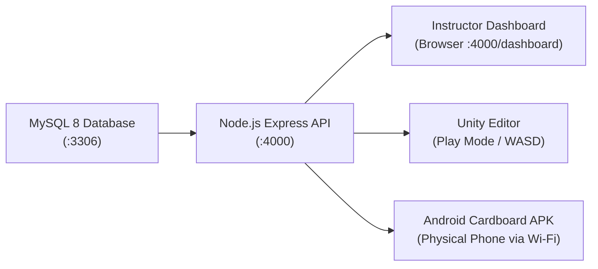

# DrillVR

An AI-driven mobile VR educational prototype for live building emergency response training drills, built with **Unity 2022.3 LTS (Google Cardboard XR)**, **Node.js 20+ Express**, **MySQL 8**, and a **Chart.js Instructor Dashboard**.

> **Educational Prototype Disclaimer:** DrillVR is an academic prototype inspired by the problem statement *"Augmented/Virtual Reality system for the live training of troops"* (Ministry of Home Affairs, 2023, Smart Automation, Software). It contains **no weapons or combat content**. Simulation scores are for educational demonstration only and must not be presented as proof of real-world qualification. Augmented Reality (AR) is future scope only.

---

## Table of Contents
1. [Course Requirements Demonstrated](#course-requirements-demonstrated)
2. [Tech Stack](#tech-stack)
3. [Repository Layout](#repository-layout)
4. [Core Drill Scenario (7 Steps)](#core-drill-scenario-7-steps)
5. [Database Design (3NF) & REST API](#database-design-3nf--rest-api)
6. [Seeded Test Accounts](#seeded-test-accounts)
7. [Comprehensive "How to Run" Guide](#comprehensive-how-to-run-guide)
   - [Prerequisites](#prerequisites)
   - [Part 1: Backend, Database & Instructor Dashboard](#part-1-backend-database--instructor-dashboard)
   - [Part 2: Unity Editor Test Mode (No Phone Needed)](#part-2-unity-editor-test-mode-no-phone-needed)
   - [Part 3: Android Physical Phone + Google Cardboard APK](#part-3-android-physical-phone--google-cardboard-apk)
   - [Part 4: Offline Queue & Resilience Testing](#part-4-offline-queue--resilience-testing)
   - [Part 5: Troubleshooting & Common Gotchas](#part-5-troubleshooting--common-gotchas)
8. [Milestones Summary (M1 to M9)](#milestones-summary-m1-to-m9)
9. [Documentation & Viva Resources](#documentation--viva-resources)

---

## Course Requirements Demonstrated

1. **Mobile VR Application Development (Unity 3D):**
   - Stereoscopic rendering via Google Cardboard XR SDK (`com.google.xr.cardboard` pinned at `#v1.30.0`).
   - Hands-free gaze interaction with a dynamic reticle and a `1.5s` radial fill dwell timer, alongside single-tap screen touch support.
   - Comfortable point-and-teleport locomotion via dedicated floor pads with parabolic gaze arc.
   - Low-draw-call, mobile-optimized environment using Unity 3D primitives, baked lightmaps, ambient audio, and a live in-VR FPS counter targeting `30+ FPS` (typically `45–60 FPS`).
   - Seamless Editor test harness: mouse look (holding Right Mouse Button or toggling cursor lock with `L`), keyboard WASD walking, and left-click interaction.

2. **Basic AI Inside VR:**
   - **Casualty NPCs (`CasualtyAI`):** Unity `NavMeshAgent` state machine (`Idle`, `Panic`, `Following`, `Safe`) with dynamic waypoint patrol, smoke-proximity flee response, and doorway/stairwell pathfinding.
   - **Dynamic Hazard Simulation (`HazardSystem`):** Expanding smoke zone (`ParticleSystem` + trigger `SphereCollider`) whose radial spread speed scales with trainee difficulty tier.
   - **Virtual Instructor (`HintSystem`):** Context-aware guidance panel driven by the active step and trainee mistake history (toggleable on/off).
   - **Adaptive Difficulty Engine (`difficultyService.js`):** Evaluates the trainee's rolling 5-session average mistakes (`avg <= 2` → `harder` at `1.35x` hazard speed; `3–5` → `normal` at `1.00x`; `> 5` → `easier` at `0.70x` with extra hints enabled).

3. **Sound Application Design with Backend & DBMS:**
   - **Database:** Normalized 3NF MySQL 8 schema (5 tables: `users`, `scenarios`, `scenario_steps`, `sessions`, `session_step_logs`) with foreign keys, cascading constraints, and compound indexes.
   - **Backend API:** Node.js 20+ Express server with parameterized SQL queries via `mysql2/promise` (zero SQL injection), JWT authentication, `bcrypt` password hashing, and role-based access control (`trainee`, `instructor`, `admin`).
   - **Transaction Integrity:** Session creation and multi-step telemetry logs persist atomically within a single database transaction (`BEGIN...COMMIT / ROLLBACK`).
   - **Offline Resilience:** Unity client queues session logs in persistent JSON storage (`pending_sessions.json`) if the network drops, automatically flushing when connectivity restores.
   - **Automated Verification:** Comprehensive Jest + Supertest integration test suite covering auth, difficulty rules, session transactions, and RBAC routes.
   - **Analytics Dashboard:** Responsive Instructor Dashboard built with HTML5, CSS3, Vanilla JS, and Chart.js, rendering trainee performance metrics, step completion bar charts, and historical trends.

---

## Tech Stack

| Layer | Technologies |
|---|---|
| **Mobile VR Client** | Unity `2022.3 LTS` (Built-in Render Pipeline, C#), `com.google.xr.cardboard` (`#v1.30.0`), `com.unity.xr.management` (`4.5.4`), `com.unity.xr.legacyinputhelpers` (`2.1.11`), `com.unity.ai.navigation` (`1.1.7`) |
| **Backend API** | Node.js `20+`, Express `4`, `mysql2` (promise pool), `jsonwebtoken`, `bcrypt`, `cors`, `dotenv` |
| **Database** | MySQL `8.0+` (3NF relational design, parameterized queries) |
| **Automated Testing** | `Jest` `29+`, `Supertest` `7+` |
| **Instructor Dashboard** | HTML5, CSS3 (flexbox/grid dark theme), Vanilla JavaScript (Fetch API), Chart.js `4.4.4` |
| **Target Mobile Device** | Android 8.0+ (API 26 to 34+), ARM64 / ARMv7, Google Cardboard VR viewer |

---

## Repository Layout

```text
DrillVR/
├── unity-client/
│   ├── Packages/
│   │   └── manifest.json               # Pinned Cardboard XR & AI Navigation packages
│   └── Assets/
│       ├── Editor/                     # Automated scene & ScriptableObject builders (M1–M8)
│       │   ├── Milestone1Setup.cs      # XR bootstrap & reticle test scene
│       │   ├── Milestone2Setup.cs      # 3D building, lighting bake, ambient audio, FPS counter
│       │   ├── Milestone3Setup.cs      # GazeInteractor, teleport points, world UI
│       │   ├── Milestone4Setup.cs      # MissionManager, HazardSystem, EquipmentSystem
│       │   ├── Milestone5Setup.cs      # CasualtyAI NavMesh FSM, RescueSystem
│       │   ├── Milestone6Setup.cs      # AssessmentManager, HintSystem, DebriefPanel
│       │   └── Milestone8Setup.cs      # ApiClient, OfflineQueue, BackendFlowController
│       ├── ScriptableObjects/          # Generated ScenarioConfig, StepData, EquipmentData assets
│       └── Scripts/
│           ├── AI/                     # CasualtyAI.cs, HintSystem.cs
│           ├── Assessment/             # AssessmentManager.cs (deterministic formula)
│           ├── Core/                   # CardboardBootstrap.cs, MissionManager.cs, ScenarioConfig.cs, StepData.cs
│           ├── Environment/            # DoorController.cs, AmbientAudioController.cs, SafeRouteZone.cs
│           ├── Equipment/              # EquipmentData.cs, EquipmentSelectionSystem.cs, EquipmentInteractable.cs
│           ├── Hazards/                # HazardSystem.cs, SituationAssessmentTracker.cs
│           ├── Interactions/           # GazeInteractor.cs, Interactable.cs, TeleportPoint.cs, GazeButton.cs, DoorInteractable.cs
│           ├── Network/                # ApiClient.cs, ApiDtos.cs, OfflineSessionQueue.cs, DrillBackendSync.cs
│           ├── Player/                 # EditorWalkController.cs (WASD + mouse look)
│           ├── Rescue/                 # RescueSystem.cs, EvacuationSystem.cs, CasualtyInteractable.cs
│           └── UI/                     # UIManager.cs, DrillHudController.cs, DebriefPanelController.cs, BackendFlowController.cs, FpsOverlay.cs
├── backend/
│   ├── db/
│   │   ├── schema.sql                  # 3NF 5-table MySQL 8 schema with FKs & indexes
│   │   └── seed.sql                    # 6 users, 3 scenarios, 7 steps, 20 sample sessions
│   ├── docs/
│   │   ├── ER_DIAGRAM.md               # Mermaid ER diagram & 3NF verification notes
│   │   └── DrillVR_API.postman_collection.json # Ready-to-import API test collection
│   ├── src/
│   │   ├── app.js & server.js          # Express app entry & server binding (0.0.0.0:4000)
│   │   ├── config/db.js                # MySQL2 connection pool with retry & health check
│   │   ├── middleware/                 # auth.js (JWT + RBAC), errorHandler.js ({ error: { code, message } })
│   │   ├── routes/                     # authRoutes, scenarioRoutes, sessionRoutes, userRoutes, instructorRoutes
│   │   ├── services/difficultyService.js # 5-session rolling difficulty algorithm
│   │   └── scripts/initDb.js           # CLI script to execute schema.sql + seed.sql
│   └── tests/
│       ├── api.test.js                 # Supertest integration tests for all REST endpoints
│       └── difficulty.test.js          # Unit tests for adaptive difficulty logic
├── dashboard/
│   ├── index.html                      # Instructor dashboard UI (stats, Chart.js, trainee table)
│   ├── styles.css                      # Modern dark theme responsive styling
│   └── app.js                          # Client-side JWT auth, API fetching, Chart.js rendering
└── docs/
    ├── ARCHITECTURE_DIAGRAMS.md        # System architecture, CasualtyAI FSM, 7-step sequence diagrams
    ├── TEST_PLAN.md                    # Master test-case matrix, AI difficulty matrix, FPS logs
    └── DEMO_AND_VIVA_GUIDE.md          # APK checklist, 3-5 min video shotlist, viva Q&A notes
```

---

## Core Drill Scenario (7 Steps)

The primary simulation is **Building Emergency Response Drill** (`building_emergency_drill`). All steps, items, hints, and scoring weights are authored in Unity `ScriptableObject`s and can dynamically sync with the MySQL database:

1. **Step 1: Briefing**
   - **Objective:** Trainee spawns at Command Post, reviews safety instructions, and confirms readiness.
   - **Interaction:** Gaze-dwell (1.5s) on the `[ CONFIRM BRIEFING ]` button on the briefing console.
2. **Step 2: Assess Situation**
   - **Objective:** Survey the facility, identify the origin of smoke, and inspect the blocked East Exit.
   - **Interaction:** Teleport down Hallway A, dwell on the Hazard Assessment point and Blocked Door notice.
3. **Step 3: Equipment Selection**
   - **Objective:** Select required safety gear while ignoring distractor items.
   - **Required Items:** Respirator Mask, Emergency Flashlight, First Aid Kit.
   - **Distractors:** Office Laptop, Cardboard Box (picking distractors incurs a score penalty).
4. **Step 4: Search & Locate Casualties**
   - **Objective:** Search rooms to locate all 3 civilian casualties.
   - **Interaction:** Approach and dwell on each `CasualtyAI` NPC. They acknowledge the trainee and transition to `Following` mode.
5. **Step 5: Evacuate via Safe Route**
   - **Objective:** Guide following casualties through the North Stairwell to the exterior Safe Assembly Zone while avoiding spreading smoke.
   - **Interaction:** Teleport along the safe route. Step completes when all 3 casualties cross the `SafeRouteZone` trigger.
6. **Step 6: Report to Command Post**
   - **Objective:** Return to the Command Post and transmit an evacuation completion report via the two-way radio.
   - **Interaction:** Dwell on the Command Post Radio interactable.
7. **Step 7: Debrief & Performance Score**
   - **Objective:** Review comprehensive evaluation debrief.
   - **Display:** Total score (`0–100`), individual step times, mistakes count, areas to improve, adaptive difficulty adjustment, and sync status to MySQL.

*(Two additional scenarios—`tunnel_smoke_evacuation` and `warehouse_hazmat_response`—are seeded in the database as inactive future-scope templates).*

---

## Database Design (3NF) & REST API

### 3NF Schema Overview (`backend/db/schema.sql`)
- **`users`**: Trainees, instructors, and admins with bcrypt-hashed credentials and roles.
- **`scenarios`**: Training scenarios (`code`, `name`, `difficulty_tier`, `time_limit_seconds`, `is_active`).
- **`scenario_steps`**: Ordered drill stages with target times, mistake penalties, and guidance hints.
- **`sessions`**: Header record for each completed drill (score, total time, mistakes, casualties rescued, hazard spread, sync timestamp).
- **`session_step_logs`**: Granular per-step execution logs linked via foreign key to `sessions` (step number, step time, mistakes count, completed status).

Full schema documentation and ER diagram: [ER_DIAGRAM.md](backend/docs/ER_DIAGRAM.md).

### REST API Endpoints
All API endpoints return standard JSON responses with error contracts formatted as `{ "error": { "code": "...", "message": "..." } }`.

| Method | Endpoint | Access | Description |
|---|---|---|---|
| `GET` | `/api/health` | Public | System status and database ping |
| `POST` | `/api/auth/register` | Public | Register a new trainee account |
| `POST` | `/api/auth/login` | Public | Login with email & password (returns signed JWT) |
| `GET` | `/api/scenarios` | Authenticated | List all available training scenarios |
| `GET` | `/api/scenarios/:idOrCode/steps` | Authenticated | Fetch ordered steps and hints for a scenario |
| `POST` | `/api/sessions` | Authenticated | Persist session + step logs in a **single MySQL transaction** |
| `GET` | `/api/users/me/history` | Authenticated | Retrieve session history for current user |
| `GET` | `/api/users/me/difficulty` | Authenticated | Compute adaptive difficulty from last 5 sessions |
| `GET` | `/api/leaderboard` | Authenticated | Retrieve top trainee scores |
| `GET` | `/api/instructor/trainees/summary` | Instructor/Admin | Get cohort metrics, averages, and weakest steps |

---

## Seeded Test Accounts

Run `npm run db:seed` in `backend/` to populate these test accounts:

| Role | Email | Password | Seeded Profile & Difficulty |
|---|---|---|---|
| **Instructor** | `instructor@drillvr.edu` | `Instructor@123` | Full dashboard & cohort management access |
| **Admin** | `admin@drillvr.edu` | `Admin@123` | System administrator access |
| **Trainee** | `aarav@drillvr.edu` | `Trainee@123` | High performer: 5 sessions, avg mistakes `1.2` → **Harder** (`1.35x` hazard speed) |
| **Trainee** | `diya@drillvr.edu` | `Trainee@123` | Consistent: 5 sessions, avg mistakes `3.8` → **Normal** (`1.00x` hazard speed) |
| **Trainee** | `kabir@drillvr.edu` | `Trainee@123` | Needs support: 5 sessions, avg mistakes `6.8` → **Easier** (`0.70x` + hints enabled) |
| **Trainee** | `meera@drillvr.edu` | `Trainee@123` | Balanced: 5 sessions, avg mistakes `2.8` → **Normal** (`1.00x` hazard speed) |

---

## Comprehensive "How to Run" Guide

Follow these step-by-step instructions to run the entire DrillVR system.



---

### Prerequisites

| Component | Minimum Version | Installation / Notes |
|---|---|---|
| **Operating System** | macOS 12+, Ubuntu 20.04+, or Windows 10/11 | Development host |
| **Node.js & npm** | Node `v20.x` or `v22.x`, npm `9+` | Installed on system PATH |
| **MySQL Database** | MySQL `8.0+` | Running locally or via Docker |
| **Unity Editor** | Unity `2022.3 LTS` (e.g. `2022.3.20f1`+) | Installed via Unity Hub |
| **Unity Modules** | **Android Build Support** | Check *Android SDK & NDK Tools* + *OpenJDK* in Unity Hub |
| **Mobile Device** *(for APK)* | Android 8.0+ (Oreo) phone | USB debugging enabled, Google Cardboard viewer |

---

### Part 1: Backend, Database & Instructor Dashboard

#### 1.1 Start MySQL 8
Make sure your MySQL 8 service is running.

- **macOS (Homebrew):**
  ```bash
  # Install if not already installed:
  brew install mysql
  # Start the background service:
  brew services start mysql
  ```
- **Ubuntu / Debian:**
  ```bash
  sudo systemctl start mysql
  ```
- **Windows:**
  Start the `MySQL80` service from the Windows Services app or run `net start MySQL80`.
- **Docker Alternative:**
  ```bash
  docker run -d --name drillvr-mysql -p 3306:3306 -e MYSQL_ROOT_PASSWORD=root -e MYSQL_DATABASE=drillvr mysql:8
  ```

#### 1.2 Configure Environment Variables
Navigate to the `backend/` directory:
```bash
cd /Users/shloksharma/Desktop/DrillVR/backend
cp .env.example .env
```
Open `.env` in an editor and configure your database credentials:
```ini
PORT=4000
DB_HOST=127.0.0.1
DB_PORT=3306
DB_USER=root
DB_PASSWORD=your_mysql_password
DB_NAME=drillvr
JWT_SECRET=super_secret_jwt_key_drillvr_2026_mha
JWT_EXPIRES_IN=24h
CORS_ORIGIN=*
```

#### 1.3 Install Dependencies
```bash
npm install
```

#### 1.4 Initialize & Seed the Database
Run the automated seed script to create the database schema, all 5 3NF tables, default scenarios, steps, and sample session telemetry:
```bash
npm run db:seed
```
*Expected output:*
```text
[initDb] Connected to MySQL server.
[initDb] Executing schema.sql...
[initDb] Executing seed.sql...
[initDb] Database drillvr initialized and seeded successfully.
```

#### 1.5 Run Automated Verification Tests
Execute the Jest + Supertest test suite to verify all endpoints and difficulty algorithms:
```bash
npm test
```
*All tests across `difficulty.test.js` and `api.test.js` should pass.*

#### 1.6 Start the Express Server
```bash
npm start
```
*The server binds to `0.0.0.0:4000`, making it accessible to both local browsers and mobile devices on your local Wi-Fi.*

#### 1.7 Open the Instructor Dashboard
1. Open your web browser and navigate to:
   ```text
   http://localhost:4000/dashboard
   ```
2. Log in using the seeded instructor credentials:
   - **Email:** `instructor@drillvr.edu`
   - **Password:** `Instructor@123`
3. **Explore Dashboard Features:**
   - **Live Cohort Metrics:** Total trainees, drills completed, cohort average score, cohort average time.
   - **Interactive Step Time Chart:** Visualized using Chart.js, highlighting trainee duration across all 7 drill steps.
   - **Trainee Roster Table:** Individual scores, completed drills, weakest identified step, and assigned difficulty tier (`harder`, `normal`, `easier`).
   - **Leaderboard:** Real-time top trainee rankings with badges.

---

### Part 2: Unity Editor Test Mode (No Phone Needed)

You can run, test, and score the entire VR drill directly in the Unity Editor using mouse-and-keyboard controls without an Android device.

#### 2.1 Open the Project in Unity Hub
1. Launch **Unity Hub**.
2. Click **Add** → **Add project from disk**.
3. Select the folder:
   ```text
   /Users/shloksharma/Desktop/DrillVR/unity-client
   ```
4. Choose **Unity 2022.3 LTS** as the Editor version.
5. Click on the project to open it (allow Unity to import packages on first run).

#### 2.2 Verify Project Settings & XR Management
1. In the Unity menu, go to **Edit** → **Project Settings...**
2. Select **XR Plug-in Management** in the left sidebar.
3. Under the **Android** tab (robot icon):
   - Check **Initialize XR on Startup**.
   - Check **Cardboard XR Plugin**.
4. Close the Project Settings window.

#### 2.3 Build the Complete Scene via Menu Item
DrillVR includes automated scene generator scripts. You can build the complete integrated milestone scene with one click:
1. In the top Unity menu bar, click:
   ```text
   DrillVR → Setup Milestone 8 Backend Integration
   ```
2. The Editor script will instantly configure:
   - Full 3D building layout (Command Post, Hallway, Room 1, North Stairwell, Safe Assembly Zone).
   - Cardboard XR Camera rig with dynamic reticle and gaze-dwell interactor.
   - Mouse-look and WASD player controller.
   - 3 civilian `CasualtyAI` NPCs on the NavMesh.
   - Expanding smoke `HazardSystem` particle volume.
   - World-Space Mission HUD, Hint panel, and Debrief score screen.
   - `BackendFlowController` with trainee login UI and `OfflineSessionQueue`.
3. Next, bake the static environment lighting:
   ```text
   DrillVR → Bake Milestone 2 Lighting
   ```
4. Save the generated scene (`Ctrl + S` or `Cmd + S`) to `Assets/Scenes/Milestone8_Integrated.unity`.

#### 2.4 Play Mode Controls

| Action | Control (Unity Editor) | Control (Mobile VR Cardboard) |
|---|---|---|
| **Look Around / Aim Reticle** | Hold **Right Mouse Button** + Move Mouse, or press **`L`** to lock cursor | Natural head tracking (gyroscope) |
| **Walk Around** | **W, A, S, D** or **Arrow Keys** | Disabled in VR (prevents motion sickness) |
| **Comfort Teleport** | Gaze at green floor pad + dwell `1.5s` or **Left-Click** | Gaze at green floor pad + dwell `1.5s` or **Tap Screen** |
| **Interact / Press Buttons** | Gaze at interactable + dwell `1.5s` or **Left-Click** | Gaze at interactable + dwell `1.5s` or **Tap Screen** |
| **Toggle Hints** | Gaze at `[ TOGGLE HINTS ]` button on HUD | Gaze at `[ TOGGLE HINTS ]` button on HUD |

> [!NOTE]
> When typing into input fields (e.g. Email or Password in the login UI), the `EditorWalkController` automatically disables WASD walking so you can type freely without moving the player.

#### 2.5 Walkthrough of the 7 Drill Steps in Play Mode

1. **Press Play** in the Unity toolbar.
2. **Step 0: Login / Offline Mode**
   - Click into the Email field and type `aarav@drillvr.edu`, Password `Trainee@123`.
   - Click **Login & Sync**. (If your backend is running, it authenticates via JWT, fetches Aarav's difficulty tier, and sets hazard speed to `1.35x`).
   - *(Optional: Click "Play Offline" to play without backend connection).*
3. **Step 1: Briefing**
   - Turn around to face the Command Post briefing board. Dwell or click on **`[ CONFIRM BRIEFING ]`**.
4. **Step 2: Assess Situation**
   - Walk down Hallway A toward the smoke. Look at the blocked East Exit and hazard point until completed.
5. **Step 3: Equipment Selection**
   - Enter Room 1 on the left.
   - Dwell/click to collect: **Respirator Mask**, **Emergency Flashlight**, **First Aid Kit**.
   - *Avoid the Laptop and Cardboard Box (distractors).*
6. **Step 4: Search & Locate Casualties**
   - Locate the 3 casualties (Officer Raj, Civilian Priya, Worker Amit).
   - Gaze at each casualty until their dwell circle fills. They will say "Following you!" and follow behind your player.
7. **Step 5: Evacuate via Safe Route**
   - Walk/teleport through the North Stairwell to the green **Safe Assembly Zone** outside.
   - When all 3 casualties enter the zone, they transition to `Safe`.
8. **Step 6: Report to Command Post**
   - Return to the Command Post and dwell on the **Radio Console** to report completion.
9. **Step 7: Debrief & Synchronization**
   - The Debrief Panel displays your final score (`0–100`), step breakdown, mistakes, and adaptive difficulty.
   - If online, the result is saved directly into MySQL via `/api/sessions`.
   - If offline, it is stored in `pending_sessions.json` and queued for subsequent sync.

---

### Part 3: Android Physical Phone + Google Cardboard APK

To experience true stereoscopic mobile VR with head tracking on an Android smartphone:

#### 3.1 Find Your Computer's LAN IP Address
Your Android phone needs to reach your computer's Express server over your local Wi-Fi network.
- **macOS:**
  ```bash
  ipconfig getifaddr en0
  # Example output: 192.168.1.150
  ```
- **Windows:**
  ```cmd
  ipconfig
  # Look for "IPv4 Address" under your active Wi-Fi adapter (e.g. 192.168.1.150)
  ```
- **Linux:**
  ```bash
  hostname -I | awk '{print $1}'
  ```

#### 3.2 Update ApiClient Base URL in Unity
1. In Unity's Project window, search for the `ApiClient` component on the `[BACKEND_SYNC]` or `[BOOTSTRAP]` GameObject in your scene.
2. In the Inspector, change `Base Url` from `http://127.0.0.1:4000` to:
   ```text
   http://192.168.1.150:4000
   ```
   *(Replace with your actual computer's LAN IP address).*
3. Verify that your computer's firewall permits incoming connections on port `4000`.

#### 3.3 Prepare Your Android Phone
1. Connect your Android phone to your computer via a USB cable.
2. On your phone, enable **Developer Options**:
   - Go to **Settings** → **About Phone** → Tap **Build Number** 7 times.
3. In **Developer Options**, turn ON **USB Debugging**.
4. Ensure your phone is connected to the **same Wi-Fi network** as your development computer.

#### 3.4 Unity Android Build Settings
1. In Unity, go to **File** → **Build Settings...**
2. Under **Platform**, select **Android** and click **Switch Platform**.
3. Under **Scenes In Build**, ensure your integrated scene is checked:
   - `Assets/Scenes/Milestone8_Integrated.unity`
4. Click **Player Settings...** (bottom left):
   - **Company Name:** `DrillVR`
   - **Product Name:** `DrillVR`
   - **Identification → Package Name:** `com.drillvr.training`
   - **Minimum API Level:** Android 8.0 'Oreo' (API Level 26)
   - **Target API Level:** Automatic (highest installed, API 33/34 recommended)
   - **Configuration → Scripting Backend:** `IL2CPP` or `Mono` (IL2CPP recommended for performance)
   - **Target Architectures:** Check `ARM64` (and `ARMv7` if using 32-bit device)
   - **Other Settings → Allow 'http://' credentials:** Ensure set to `Always Allowed` (configured by `Milestone8Setup.cs`).
5. Close Project Settings.

#### 3.5 Build and Run
1. In the **Build Settings** window, under **Run Device**, select your connected Android smartphone.
2. Click **Build And Run**.
3. Choose a destination to save `DrillVR.apk` (e.g. `unity-client/Builds/DrillVR.apk`).
4. Unity will compile shaders, package assets, assemble the Android APK, install it via `adb`, and launch the app automatically on your phone.

#### 3.6 Cardboard Viewer Experience
1. When the app launches, you will see a stereoscopic split-screen view.
2. Insert your phone into your Google Cardboard headset.
3. Look around — gyroscopic head tracking will drive your view.
4. Aim the center reticle at buttons or teleport pads. Wait `1.5s` for the dwell circle to complete, or press the Cardboard capacitive trigger / tap the screen to trigger immediate interaction.

---

### Part 4: Offline Queue & Resilience Testing

DrillVR is built for field resilience: trainees can complete drills even if network connectivity drops entirely.

#### How It Works
- All completed sessions are formatted into `CreateSessionDto` payloads.
- If `/api/sessions` returns a network error or HTTP failure, `OfflineSessionQueue.cs` serializes the payload and appends it to:
  ```text
  <Application.persistentDataPath>/pending_sessions.json
  ```
- On the next app launch or when the trainee clicks **Sync Pending Sessions**, the client flushes each queued session to the backend in order.

#### How to Test Offline Resilience
1. In the Unity Editor or on your phone, start playing a drill.
2. Stop the backend server in your terminal (`Ctrl + C`).
3. Complete the drill to Step 7 (Debrief).
4. Observe the Debrief HUD:
   - Status message displays: `Offline: saved locally to queue`.
5. Restart your backend server (`npm start`).
6. In Unity, click **Sync Pending Sessions** or restart the drill.
7. Observe the status update to: `Synced N offline session(s) successfully`.
8. Check the Instructor Dashboard (`http://localhost:4000/dashboard`): the completed session now appears in the trainee's history with full step logs!

---

### Part 5: Troubleshooting & Common Gotchas

| Issue | Root Cause | Solution |
|---|---|---|
| `ECONNREFUSED 127.0.0.1:3306` | MySQL server is not running | Run `brew services start mysql` (macOS) or `sudo systemctl start mysql` (Linux). |
| `ER_ACCESS_DENIED_ERROR` | Incorrect database password in `backend/.env` | Update `DB_USER` and `DB_PASSWORD` in `backend/.env` to match your MySQL setup. |
| Phone shows "Network Error" on login | Phone cannot reach `127.0.0.1` | `127.0.0.1` points to the phone itself. Set `ApiClient` Base URL to your laptop's Wi-Fi IP (e.g. `http://192.168.1.150:4000`). |
| Android blocks plain HTTP traffic | Android 9+ requires HTTPS by default | Our setup scripts configure `InsecureHttpOption.AlwaysAllowed` in Unity `PlayerSettings`. If building manually, verify this setting under *Other Settings*. |
| WASD walking does not move player | Cursor is not locked, or player is typing in an input field | Press **`L`** or hold **Right Mouse Button** to capture mouse look and enable WASD movement. |
| Missing objects or missing scripts in scene | Scene was modified or opened without running setup | Click **DrillVR → Setup Milestone 8 Backend Integration** in Unity top menu to regenerate the complete hierarchy. |
| Casualties do not move / NavMesh error | Scene NavMesh has not been baked | Go to **Window → AI → Navigation** and click **Bake**, or run **DrillVR → Bake Milestone 2 Lighting**. |
| Low frame rate on low-end Android phone | Real-time dynamic shadows or unbaked lighting | In Unity, go to **DrillVR → Bake Milestone 2 Lighting** to ensure all lightmaps are baked into textures. |

---

## Milestones Summary (M1 to M9)

- [x] **Milestone 1:** Google Cardboard XR SDK bootstrap, stereoscopic camera rig, dynamic gaze reticle, dwell timer, and tap detection (`Milestone1Setup.cs`).
- [x] **Milestone 2:** 3D building environment with Unity primitives, baked lightmaps, directional lighting, spatial ambient audio, and live FPS overlay (`Milestone2Setup.cs`).
- [x] **Milestone 3:** `GazeInteractor` with radial dwell fill, `Interactable` event system, green `TeleportPoint` comfort locomotion, and World-Space UI menus (`Milestone3Setup.cs`).
- [x] **Milestone 4:** `ScenarioConfig`, `StepData`, `EquipmentData` ScriptableObjects, `MissionManager` 7-step coordinator, expanding smoke `HazardSystem`, and `EquipmentSelectionSystem` (`Milestone4Setup.cs`).
- [x] **Milestone 5:** `CasualtyAI` NavMesh state machine (`Idle`, `Panic`, `Following`, `Safe`), `RescueSystem`, `EvacuationSystem`, and hazard proximity fleeing (`Milestone5Setup.cs`).
- [x] **Milestone 6:** Deterministic `AssessmentManager` scoring formula, context-aware `HintSystem` virtual instructor, and `DebriefPanelController` (`Milestone6Setup.cs`).
- [x] **Milestone 7:** 3NF MySQL 8 database schema (5 tables), 20-session seed dataset, Node.js + Express REST API, single-transaction persistence, and Jest integration tests (`initDb.js`, `api.test.js`).
- [x] **Milestone 8:** Unity `ApiClient`, runtime ScriptableObject cloning, adaptive difficulty synchronization, persistent `OfflineSessionQueue`, and login flow (`Milestone8Setup.cs`).
- [x] **Milestone 9:** HTML5 + Chart.js Instructor Dashboard, ER diagram, architecture flowcharts, master test plan, and demo/viva guide.

---

## Documentation & Viva Resources

Detailed technical documentation and presentation guides are available in the repository:

- 📊 **[System Architecture & State Machine Diagrams](docs/ARCHITECTURE_DIAGRAMS.md)**: Full architecture topology, `CasualtyAI` state transition diagrams, and 7-step drill sequence flows.
- 🗄️ **[Database ER Diagram & 3NF Design Notes](backend/docs/ER_DIAGRAM.md)**: Entity-relationship diagram, table constraints, and 3NF normalization justification.
- 🧪 **[Master Test Plan & Verification Matrix](docs/TEST_PLAN.md)**: Comprehensive test matrix covering unit tests, integration tests, AI difficulty validation, and device FPS benchmarks.
- 🎓 **[Demo Video Shotlist & Viva Q&A Guide](docs/DEMO_AND_VIVA_GUIDE.md)**: 3–5 minute video presentation script, rubric checklist, and anticipated examiner questions with model answers.
- 📬 **[Postman API Test Collection](backend/docs/DrillVR_API.postman_collection.json)**: Ready-to-import Postman collection for verifying all REST endpoints.
