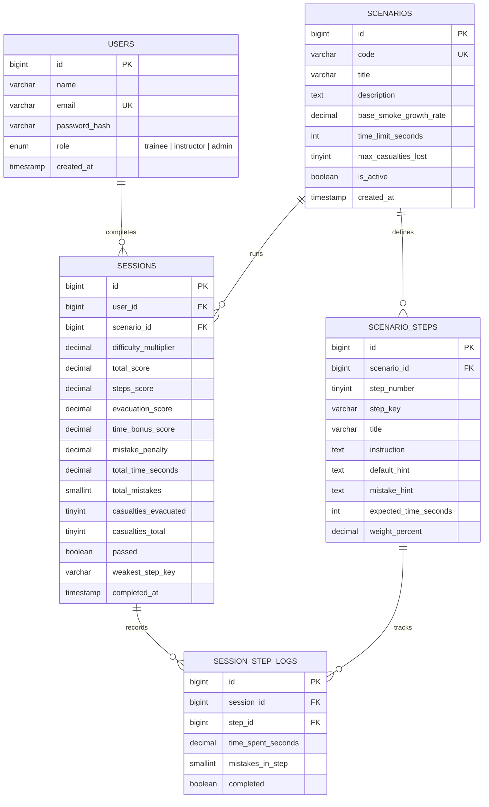

# DrillVR Entity-Relationship Diagram (3NF)

## 3NF Design Notes
- **1NF:** All columns are atomic; step logs live in `session_step_logs` rather than comma-separated lists on `sessions`.
- **2NF:** Every non-key column depends on the full primary key (`id`) of its respective table; composite uniqueness constraints `(scenario_id, step_number)` and `(session_id, step_id)` prevent duplicate entries.
- **3NF:** Scenario metadata (`title`, `base_smoke_growth_rate`) and step definitions (`title`, `expected_time_seconds`, `weight_percent`) are isolated in `scenarios` and `scenario_steps`, eliminating transitive dependencies inside `sessions` and `session_step_logs`.
- **Indexes:**
  - `idx_sessions_user_completed (user_id, completed_at DESC)` accelerates the last-5-sessions adaptive difficulty query and trainee history.
  - `idx_sessions_scenario_score (scenario_id, total_score DESC)` accelerates leaderboard queries.
  - `idx_logs_step_mistakes (step_id, mistakes_in_step)` accelerates weakest-step analytics for instructors.
